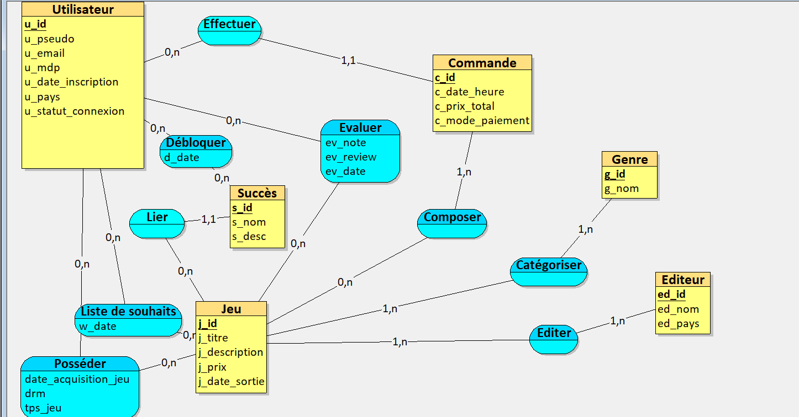
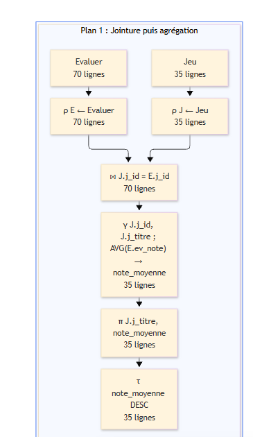
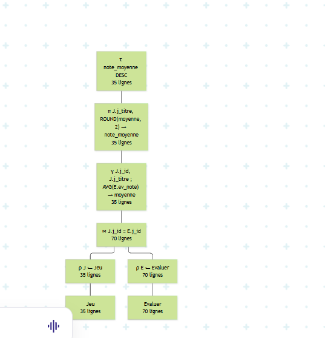

# ProjetDB_Samba_Fall_Benhamouda_Elias

## auteur : Samba Fall , Benhamouda Elias

# Prompt utilisé
Tu travailles dans le domaine de la vente. Ton [entreprise/organisation/administration] a comme activité la vente de jeux vidéo. C’est une [entreprise/organisation/administration] comme Steam,

GOG, Epic. [AJOUTER UNE LISTE DE CE SUR QUOI LES DONNEES ONT ETE COLLECTEES, SANS ETRE TROP PRECIS].
Inspire-toi des site web suivant :https://store.steampowered.com/?l=french
, https://www.gog.com/fr/, https://store.epicgames.com/
Ton entreprise veut appliquer MERISE pour concevoir un
système d'information. Tu es chargé de la partie analyse, c’est-à-dire de
collecter les besoins auprès de l’entreprise. Elle a fait appel à un étudiant
en ingénierie informatique pour réaliser ce projet, tu dois lui fournir les
informations nécessaires pour qu’il applique ensuite lui-même les étapes
suivantes de conception et développement de la base de données.
D’abord, établis les règles de
gestions des données de ton entreprise
sous la forme d'une liste à puce. Elle doit correspondre aux informations que
fournit quelqu’un qui connaît le fonctionnement de l’entreprise, mais pas
comment se construit un système d’information.
Ensuite, à partir de ces règles,
fournis un dictionnaire de données brutes avec les colonnes suivantes,
regroupées dans un tableau : signification de la donnée, type, taille en nombre
de caractères ou de chiffres. Il doit y avoir entre 25 et 35 données. Il sert à
fournir des informations supplémentaires sur chaque donnée (taille et type)
mais sans a priori sur comment les données vont être modélisées ensuite.
Fournis donc les règles de
gestion et le dictionnaire de données.

# Règles de gestion des données 

## Gestion des utilisateurs:
 Tout utilisateur possède un profil unique identifié par un pseudo, une adresse email, un mot de passe haché, une date d'inscription, un pays de résidence et un statut de connexion.

## Gestion des éditeurs et développeurs :
 Un jeu est rattaché à un éditeur ou un studio de développement (nom, pays d'origine). Un éditeur peut publier un ou plusieurs jeux.

## Catalogue des jeux :
 Un jeu se caractérise par son titre, sa description détaillée, son prix de base et sa date de sortie officielle.

## Catégorisation des jeux :
 Un jeu peut être associé à plusieurs genres ou catégories (ex: Action, RPG, Simulation), et une catégorie regroupe plusieurs jeux.

## Gestion des achats et commandes : Un utilisateur peut passer des commandes contenant un ou plusieurs jeux. Chaque commande est enregistrée avec sa date et heure, son montant total et le mode de paiement utilisé.

## Gestion de la bibliothèque personnelle :
 Chaque utilisateur possède une bibliothèque personnelle unique. Tout jeu acheté s'y ajoute automatiquement. La bibliothèque centralise pour chaque jeu possédé : une date d'acquisition, une clé de licence unique (DRM), et un suivi précis du temps de jeu cumulé (en heures).

## Système d'évaluations :
 Un utilisateur possédant un jeu dans sa bibliothèque peut laisser une (et une seule) évaluation pour ce jeu, comprenant une note chiffrée, un commentaire textuel et la date de rédaction.

## Liste de souhaits (Wishlist) :
 Un utilisateur peut ajouter des jeux à sa liste de souhaits personnelle pour planifier un achat futur, avec mémorisation de la date d'ajout.

## Gestion des succès (Achievements) :
 Chaque jeu propose une liste de succès ou trophées (nom, description de l'objectif). Le système enregistre la date et l'heure exactes de déblocage de chaque succès par un utilisateur.

## 2. Dictionnaire de données brutes (34 données)

| N° | Signification de la donnée | Type | Taille |
|---:|---|---|---|
| 1 | Identifiant unique de l'utilisateur | Integer | 8 chiffres |
| 2 | Pseudo de l'utilisateur | Varchar | 30 caractères |
| 3 | Adresse email de l'utilisateur | Varchar | 100 caractères |
| 4 | Mot de passe haché | Varchar | 255 caractères |
| 5 | Date d'inscription de l'utilisateur | DATE | 10 caractères |
| 6 | Pays de résidence de l'utilisateur | Varchar | 50 caractères |
| 7 | Statut de connexion de l'utilisateur | Varchar | 20 caractères |
| 8 | Identifiant unique du jeu | Integer | 8 chiffres |
| 9 | Titre du jeu | Varchar | 150 caractères |
| 10 | Description complète du jeu | Varchar | 2000 caractères |
| 11 | Prix de base du jeu | Float | 6 chiffres (ex: 999.99) |
| 12 | Date de sortie officielle du jeu | DATE | 10 caractères |
| 13 | Identifiant unique de l'éditeur | Integer | 6 chiffres |
| 14 | Nom de l'éditeur | Varchar | 100 caractères |
| 15 | Pays du siège de l'éditeur | Varchar | 50 caractères |
| 16 | Identifiant unique de la catégorie | Integer | 4 chiffres |
| 17 | Nom de la catégorie (Genre) | Varchar | 50 caractères |
| 18 | Identifiant unique de la commande | Integer | 10 chiffres |
| 19 | Date et heure de la commande | DATETIME | 19 caractères (AAAA-MM-JJ HH:MM:SS) |
| 20 | Montant total payé pour la commande | Float | 6 chiffres |
| 21 | Mode de paiement utilisé | Varchar | 30 caractères |
| 22 | Identifiant unique de la bibliothèque | Integer | 8 chiffres |
| 23 | Date d'acquisition du jeu (dans la bibliothèque) | DATE | 10 caractères |
| 24 | Clé de licence unique (DRM) | Varchar | 50 caractères |
| 25 | Temps de jeu cumulé (en heures) | Float | 7 chiffres (ex: 1250.5) |
| 26 | Identifiant unique de l'évaluation | Integer | 10 chiffres |
| 27 | Note attribuée au jeu | Integer | 2 chiffres |
| 28 | Commentaire textuel de l'évaluation | Varchar | 1000 caractères |
| 29 | Date de rédaction de l'évaluation | DATE | 10 caractères |
| 30 | Date d'ajout d'un jeu à la liste de souhaits | DATE | 10 caractères |
| 31 | Identifiant unique du succès (trophée) | Integer | 6 chiffres |
| 32 | Nom du succès | Varchar | 100 caractères |
| 33 | Description de l'objectif du succès | Varchar | 250 caractères |
| 34 | Date et heure d'obtention du succès | DATETIME | 19 caractères (AAAA-MM-JJ HH:MM:SS) |

## MCD

## MLD

Utilisateur = (u_id INT, u_pseudo VARCHAR(50), u_email VARCHAR(100), u_mdp VARCHAR(255), u_date_inscription DATE, u_pays VARCHAR(50), u_statut_connexion VARCHAR(20));
Editeur = (ed_id INT, ed_nom VARCHAR(100), ed_pays VARCHAR(50));
Commande = (c_id INT, c_date_heure DATETIME, c_prix_total REAL, c_mode_paiement VARCHAR(50), #u_id);
Jeu = (j_id INT, j_titre VARCHAR(150), j_description VARCHAR(2000), j_prix REAL, j_date_sortie DATE);
Genre = (g_id INT, g_nom VARCHAR(50));
Succès = (s_id INT, s_nom VARCHAR(100), s_desc VARCHAR(250), #j_id);
Posséder = (#u_id, #j_id, date_acquisition_jeu DATE, drm VARCHAR(50), tps_jeu REAL);
Editer = (#ed_id, #j_id);
Catégoriser = (#j_id, #g_id);
Evaluer = (#u_id, #j_id, ev_note INT, ev_review VARCHAR(1000), ev_date DATE);
Composer = (#c_id, #j_id);
Liste_de_souhaits = (#u_id, #j_id, w_date DATE);
Débloquer = (#u_id, #s_id, d_date DATETIME);

## Scénario d'utilisation

### Cas utilisation 1 

Un utilisateur souhaite consulter les jeux proposés sur la plateforme mais a un budget restreint pour les jeux vidéo. Ainsi la plateforme va lui afficher les jeux dont le prix est compris entre 10 € et 20 €. La requête lui permet d'obtenir le titre, la description et le prix de chaque jeu correspondant à cette tranche tarifaire afin de comparer les offres et de choisir un jeu adapté à son budget.

### Cas utilisation 2 

Un utilisateur souhaite consulter les jeux disponibles sur la plateforme en fonction de leur genre. Cette requête permet d'afficher le titre et la description de chaque jeu, ainsi que son genre, afin de faciliter la recherche d'un jeu correspondant à ses préférences.

### Cas d'utilisation 3 

Un utilisateur souhaite consulter l'historique de ses commandes sur la plateforme. Cette fonctionnalité permet de retrouver les jeux qu'il a achetés, les dates auxquelles il a effectué ses commandes ainsi que le montant total de chaque commande. Cela lui permet de suivre ses achats et de conserver une trace de ses transactions.

### Cas utilisation 4

La plateforme souhaite connaître la répartition  de ses utilisateurs par pays afin d'identifier lesquels compte le plus de joueurs. Les résultats sont classés par ordre décroissant du nombre d'utilisateurs.

### Cas utilisation 5

Un utilisateur souhaite consulter les jeux qu'il a ajoutés à sa liste de souhaits. Cette requête permet à la plateforme d'afficher les jeux associés à chaque utilisateur, en regroupant visuellement les résultats par pseudo et en triant les titres par ordre alphabétique.

###  Cas utilisation 6

La plateforme souhaite connaître la répartition des joueurs par pays pour chacun des jeux proposés. Cette requête permet d'identifier les pays comptant le plus de joueurs pour chaque jeu et de mieux comprendre sa popularité à l'international.

###  Cas utilisation 7

La plateforme souhaite permettre aux utilisateurs de consulter les notes moyennes attribuées aux différents jeux. Cette requête calcule la moyenne des évaluations pour chaque jeu et classe les résultats du mieux noté au moins bien noté. Cela peut ainsi aider les utilisateurs à choisir un jeu.

### Cas d'utilisation 8

La plateforme souhaite connaître le niveau moyen de progression des joueurs dans les différents jeux. Cette requête permet de calculer le pourcentage moyen de succès débloqués par les joueurs possédant chaque jeu, y compris ceux qui n'ont encore débloqué aucun succès. Cela permet aux joueurs de comparer leur progression avec celle des autres joueurs.

### cas utilisation 9

La plateforme peut identifier les succès les plus difficiles à obtenir pour chaque jeu. Cette requête permet de déterminer le succès débloqué par le plus petit nombre de joueurs. En cas d'égalité, un seul succès est sélectionné. Cela permet aux joueurs de découvrir les succès les plus rares et de connaître leur niveau de rareté.

### Analyse exécution : 

**Contexte** :La requête qui fut choisie est la requête sur la moyenne des notes des jeux du cas d'utilisation 7.

### Plans 1 : Jointure puis agrégation
Dans le premier plan, nous effectuons d'abord une jointure entre les relations Jeu et Evaluer sur l'identifiant du jeu. Nous procédons ensuite au regroupement des évaluations par jeu afin de calculer la moyenne des notes.

La jointure produit 70 lignes, qui sont ensuite regroupées pour obtenir 35 lignes. Le résultat est finalement projeté et trié par moyenne décroissante.

#### Plans 2 : Agrégation puis jointure 

Dans le deuxième plan, nous commençons par regrouper les évaluations selon l'identifiant du jeu afin de calculer directement une moyenne pour chaque jeu. Cette opération réduit les 70 lignes initiales de la relation Evaluer à 35 lignes.

Nous effectuons ensuite la jointure avec la relation Jeu, qui contient 35 lignes. Le résultat de cette jointure comporte 35 lignes. Nous conservons ensuite le titre et la moyenne des notes avant de procéder au tri.

#### Comparaison et choix du meilleur plan

Les deux permettent d'obtenir le même résultat final. Cependant, le deuxième plan présente un avantage : la jointure est effectuée après l'agrégation des évaluations.

Le premier plan produit 70 lignes lors de la jointure, tandis que le deuxième n'en produit que 35. Le deuxième plan limite donc le nombre de lignes intermédiaires manipulées lors de cette opération.

Nous retenons ainsi le deuxième plan comme étant le plus intéressant en matière de réduction des données intermédiaires, même si le coût réel dépend également des algorithmes utilisés pour effectuer les jointures et les agrégations.